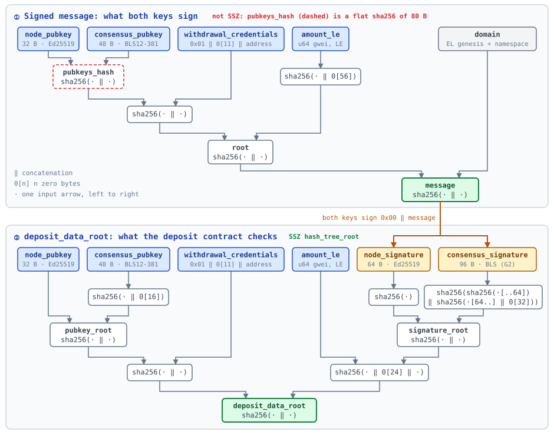

# Deposits and Withdrawals

## Deposits
- **Submitting a deposit**
  - Deposits follow EIP-6110, but the [deposit contract](https://github.com/SeismicSystems/seismic/blob/main/contracts/src/predeploys/DepositContract.sol) takes two validator keys: `deposit()` takes `node_pubkey` (Ed25519, 32 B), `consensus_pubkey` (BLS12-381, 48 B), `withdrawal_credentials` (`0x01 ‖ 11 zero bytes ‖ address`), a signature from each key, and `deposit_data_root`. The amount is `msg.value`.
  - Operators don't build these by hand: `getDepositSignature` on the admin RPC returns all six for a given amount and address (see [staking-and-participating.md](staking-and-participating.md)).
  - Both keys sign the same message. It commits to the keys, the withdrawal credentials, the amount, and a domain tied to one network (its EL genesis hash and Summit's namespace), so a deposit signed for one network is invalid on any other. Every deposit, top-ups included, needs its own signature. See [Deposit data](#deposit-data) for the layout.
  - The contract recomputes `deposit_data_root` from the other fields and checks field lengths, the credential format, and `msg.value` (at least 1 ether, a whole number of gwei), reverting on any mismatch. It does **not** check signatures; Summit does (see below).
- **Stake and activation**
  - Potential validators have to deposit at least **MINIMUM_STAKE** to join the network.
  - If a potential validator makes an initial deposit with *amount* < **MINIMUM_STAKE**, then the validator account is still created, but it won't be set to active.
  - Top-up deposits are allowed.
  - Once a processed deposit brings an inactive validator's balance to at least **MINIMUM_STAKE**, activation is scheduled **VALIDATOR_NUM_WARM_UP_EPOCHS** later, provided fewer than **MAX_VALIDATOR_COUNT** validators are active or joining. Deposit processing occurs near epoch end and is subject to **MAX_DEPOSITS_PER_EPOCH**, so activation may be delayed from submission.
  - If **MAX_VALIDATOR_COUNT** is already occupied by active and joining validators, a valid deposit is still credited but the validator remains inactive and no activation is scheduled.
  - If a deposit lands for an account that no longer exists, then a new account is created.
- **Invalid deposits**
  - Deposit requests with invalid signatures will be refunded as a withdrawal. K% of the deposited amount (**INVALID_DEPOSIT_TAX**, default 5%) is sent to the treasury address (the zero address by default, which effectively burns it). This prevents invalid deposits from becoming a DDOS vector.
  - If the deposit's keys are malformed, it is refunded with the same K% tax applied to invalid signatures.
  - If the deposit's consensus (BLS) key does not match the key already on the account (or is already used by another validator), the deposit is refunded with the same K% tax applied to invalid signatures.

### Deposit data



For implementers signing outside Summit, the reference code is `DepositRequest::as_message` and `compute_deposit_data_root` in [`types/src/execution_request.rs`](../types/src/execution_request.rs). Easy to get wrong:
- Each key signs `0x00 ‖ message`, not `message`: commonware's `sign` prefixes the (empty) namespace's length. BLS uses the DST `BLS_SIG_BLS12381G2_XMD:SHA-256_SSWU_RO_POP_`.
- The message is not SSZ: `pubkeys_hash` is a flat hash of the two keys. `deposit_data_root` is an SSZ `hash_tree_root`, as in Ethereum.
- The amount is in gwei, as a little-endian `u64`, as in Ethereum; the contract converts `msg.value` itself.

## Withdrawals
- **Requesting a withdrawal**
  - Withdrawals follow the EIP-7002 spec.
  - A withdrawal is accepted only when its source address matches the validator's withdrawal credentials and the validator has not reached **MAX_PENDING_WITHDRAWALS_PER_VALIDATOR**.
- **Partial withdrawals**
  - Partial withdrawals are allowed. Active validators retain at least **MINIMUM_STAKE**. Inactive validators have no minimum balance floor, and a withdrawal from a joining validator first cancels its activation.
  - Multiple partial withdrawals may be pending, up to **MAX_PENDING_WITHDRAWALS_PER_VALIDATOR**. At payout, each partial withdrawal is capped again using the current balance and prospective **MINIMUM_STAKE**.
- **Full exits**
  - For an active validator, amount=0 requests a full exit. The request is rejected if the exit would leave fewer than **MINIMUM_VALIDATOR_COUNT** active validators.
  - An accepted full exit processed in epoch E removes the validator at the end of E and schedules its payout for epoch **E + VALIDATOR_WITHDRAWAL_NUM_EPOCHS**. **MAX_WITHDRAWALS_PER_EPOCH** may delay the payout.
- **Timing and payout limits**
  - Requests included in the last block of epoch E remain buffered until the penultimate block of E+1. An accepted exit then occurs at the end of E+1, with payout scheduled for epoch **E + 1 + VALIDATOR_WITHDRAWAL_NUM_EPOCHS**, subject to the withdrawal cap.
  - **MAX_WITHDRAWALS_PER_EPOCH** is a total payout cap. Validator withdrawals take priority over deposit refunds, and overflow remains queued for a later epoch.
  - An invalid deposit may create separate refund and treasury withdrawals. Each withdrawal consumes one slot under the payout cap.

## Validator Count Limits
- **The limit**
  - **MAX_VALIDATOR_COUNT** (`MaxValidatorCount`, configured in genesis as `max_validator_count`) defaults to **128** and accepts values from **1 to 4,096**. It limits admission of **Active + Joining** validators, not the total number of stored accounts. Joining validators reserve a slot throughout warm-up.
  - Stored state must have minimum no greater than maximum. Membership can temporarily exceed the stored maximum while an accepted queued increase is already being used for admission, before boundary application. Checkpoint recovery and network sizing must account for that pending increase.
- **Changing the limits**
  - At epoch processing, the final proposed **MINIMUM_VALIDATOR_COUNT** and **MAX_VALIDATOR_COUNT** are evaluated together, using the last valid request for each. If minimum exceeds maximum, all updates to those two parameters in the pending batch are discarded before withdrawal or deposit decisions; the existing pair remains in effect. Unrelated parameter updates are retained. Valid paired changes are independent of request ordering.
  - A proposed maximum below the current **Active + Joining** count is rejected before withdrawals or deposits are processed. Equality is allowed. All pending maximum-count updates are discarded on rejection, retaining the existing maximum rather than falling back to an earlier request; other updates remain subject to minimum/maximum consistency validation. Same-batch exits or joining cancellations cannot make the reduction valid; submit a later update after membership has decreased. No validators are evicted and no activation reservations are canceled by a cap change.
  - Raising the maximum does not automatically activate funded inactive accounts. Another valid deposit must trigger admission, and any pending withdrawal still prevents reactivation.
- **Within one epoch batch**
  - Withdrawals are processed before queued deposits are credited. An accepted active full exit or joining-validator cancellation frees an admission slot for that batch; a rejected withdrawal or active partial withdrawal does not. Deposits compete for available slots in deposit-queue order.
  - A withdrawal for an account first created by a deposit in that same batch is dropped because the account does not yet exist. The deposit is still credited; a later authorized withdrawal can reclaim it. Cap-blocked inactive accounts can withdraw without the active-validator minimum-balance floor.

### Network Capacity and Restarts

Summit allocates its fixed P2P queue capacity at startup using the validator and observer limits from recovered consensus state. Accepted pending increases are included; pending reductions do not reduce the startup allocation. The capacity includes one extra slot for the local identity when it is outside the authorized peer sets:

```text
peer capacity = startup validator limit × (1 + startup observers per validator) + 1
```

With the defaults of **128 validators** and **16 observers per validator**, this is **2,177 identities per peer set**. Authorized observer identities count even when they are offline.

**Increasing `MaxValidatorCount` does not resize a running node's queues or automatically restart Summit.** To use a higher maximum that requires more peer capacity:

1. Ensure the raised value is durably recorded in each affected node's consensus state, either as an effective parameter or an accepted pending increase.
2. Coordinate restarts of the affected Summit instances so they allocate capacity using that value.
3. Restart before larger validator/observer sets exceed the previous allocation. Restarting against unchanged protocol state does not increase capacity.

A decrease, or an increase already covered by the startup allocation, does not require a restart for capacity reasons. The same capacity constraint applies when increasing the observers-per-validator parameter. If a registered peer set exceeds a node's fixed capacity, the node fails an assertion; this is an operational limit, not a node-local consensus rule rejecting the protocol parameter update.

## Validator Balance
- **Balance rules**
  - All active validators must have a balance of at least **MINIMUM_STAKE**.
  - There is no upper limit on validator balance, however, there is no advantage (such as higher chance of becoming a leader) in having a balance that exceeds **MINIMUM_STAKE**.
- **Changing MINIMUM_STAKE**
  - The **MINIMUM_STAKE** may be changed via a protocol parameter execution request.
  - If applying the updated **MINIMUM_STAKE** would leave fewer than **MINIMUM_VALIDATOR_COUNT** validators in the committee, then the change is rejected. The previous **MINIMUM_STAKE** remains in effect and no validators are removed.
- **Enforcement after an increase**
  - If **MINIMUM_STAKE** is increased during epoch E, then on the last block of epoch E, the validators with *balance* < **MINIMUM_STAKE** will be removed from the committee. The balance remains in their account and can be withdrawn at any time.
  - The epoch's deposits are processed before the updated **MINIMUM_STAKE** is enforced, so a validator's balance already includes any same-epoch deposit when enforcement runs. If a top-up in the same epoch restores a validator to at least **MINIMUM_STAKE**, it stays in the committee.
  - A validator still below **MINIMUM_STAKE** after its deposits are applied is removed from the committee and set to inactive. Its balance remains in the account and can be withdrawn at any time.
  - Joining validators with *balance* < **MINIMUM_STAKE** will have their activation canceled.
