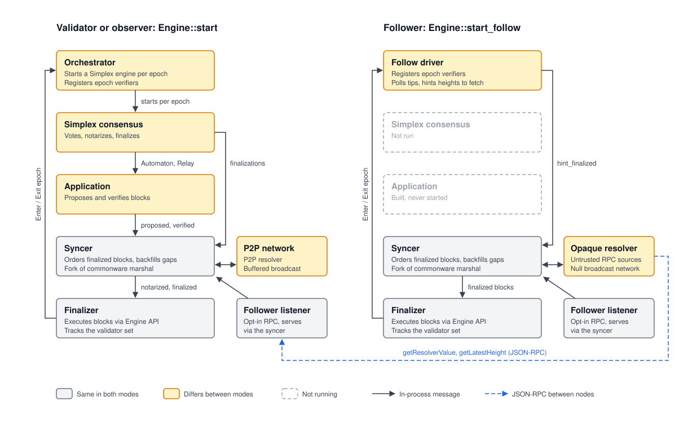
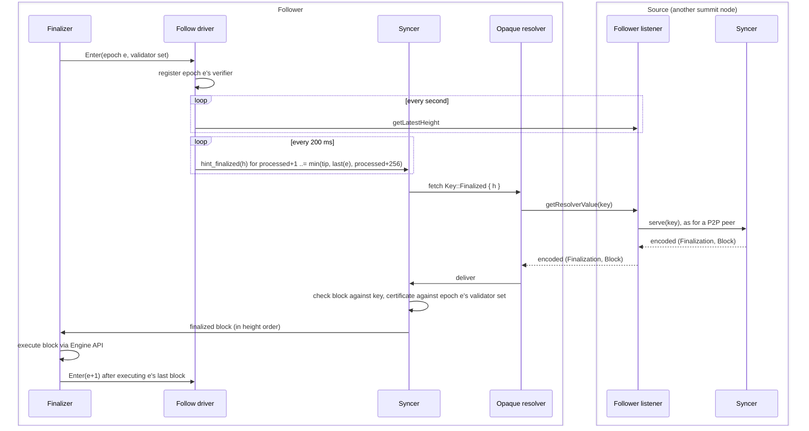

# Follow Mode

A follower is a summit node that follows the chain from other nodes' RPC instead of P2P. It runs the finalizer and syncer, so it executes every finalized block against its own execution client and tracks validator-set changes. It runs no Simplex, joins no peer set, holds no P2P identity, and reads no keystore. It costs validators nothing beyond the RPC requests it makes to the sources it picks.

Followers are useful wherever a node needs the chain's state but has no place in consensus: RPC nodes, archives, and nodes that aren't in any validator's observer set. Compare observer mode (`--observer <index>`), where the node uses a P2P identity derived from a validator's key and every validator authorizes it as a secondary peer.

## Running a follower

A follower fetches from other nodes' follower listener. That listener is off by default, so each node a follower should fetch from must enable it. It binds to loopback unless told otherwise, so a node serving followers on other hosts also sets an address they can reach:

```bash
summit run ... --follower-rpc-ip 10.0.0.5 --follower-rpc-port 3032
```

Then point the follower at those listeners:

```bash
summit run \
  --follow http://validator-a:3032,http://validator-b:3032 \
  --genesis-path ./genesis.toml \
  --engine-ipc-path /tmp/reth_engine_api.ipc \
  --store-path ~/.seismic/consensus/follower
```

- `--follow <url>...` takes one or more follower listener URLs, comma-separated or with the flag repeated. A follower can set `--follower-rpc-port` too, so other followers can follow it.
- `--follow` conflicts with `--observer`. Each mode replaces the same parts of the engine: the syncer's one backfill resolver (P2P or remote) and the one consumer of the finalizer's epoch transitions (orchestrator or follow driver). A follower can still sync from an observer that sets `--follower-rpc-port`.
- `--key-store-path` is ignored. The engine runs with throwaway keys that never sign anything or reach a network.
- The genesis, execution-client, storage, RPC, and Prometheus flags work as they do for any node. P2P flags (`--port`, `--ip`, `--bootstrappers`) are ignored.

The follower's own RPC serves the usual query methods with two differences. `getPublicKeys` returns error `4005` (no identity in follow mode), and the localhost admin listener (`getDepositSignature`) doesn't start.

## How it works

A follower runs the same syncer and finalizer as a validator. It swaps out how blocks arrive and who handles epoch transitions:





The pieces, from the serving side to the following side:

- **`getResolverValue`** (`rpc/`). The P2P backfill resolver's serving side already lives in the syncer: for a resolver `Key`, it produces the reply a P2P peer would get. This RPC method hands the key to the same handler (`Handler::try_produce` in `syncer/src/ingress/handler.rs`) and returns its reply, so RPC and P2P serve identical bytes. It is served only on the opt-in follower listener; see [The follower listener](#the-follower-listener).
- **Opaque resolver** (`syncer/src/resolver/opaque.rs`). This is a `Resolver` the syncer can use in place of the P2P one. As `resolver::p2p` wraps commonware's P2P resolver, it wraps commonware's `opaque` resolver, which fetches from untrusted request/response sources instead of P2P peers. Commonware's resolver does the coalescing, retries, and delivery bookkeeping. On top of it, this module sends each attempt to a source picked at random and bounds each attempt by the engine's fetch timeout. Transports plug in through the `Source` trait, so the syncer crate stays transport-free.
- **`RpcSource`** (`node/src/follow/source.rs`). This is the JSON-RPC `Source`, built on `getResolverValue` and `getLatestHeight`.
- **Follow driver** (`node/src/follow/driver.rs`). It runs in place of the orchestrator. It consumes the finalizer's epoch `Enter`/`Exit` messages and registers or unregisters each epoch's verifier with the scheme provider. It polls the sources for their tip in a separate task, giving each source one second to answer, so a source that hangs never delays hints or epoch transitions. It hints the syncer to fetch finalized heights. It never hints past the entered epoch's last height, because the syncer drops a finalization whose epoch verifier isn't registered. It also hints at most 256 heights past the processed height. The opaque resolver fetches every hinted height concurrently, so this window bounds the load a catching-up follower puts on its sources.
- **Null network** (`node/src/follow/null.rs`). The syncer takes commonware's buffered-broadcast mailbox, and the finalizer reports peer sets to a network oracle. In follow mode both run against a network that never delivers and an oracle with no peers.

`Engine::start_follow` (`node/src/engine.rs`) wires these together. The application and orchestrator are built but never started.

## Trust model

Sources are untrusted. Every reply goes through the syncer's `handle_deliver`, the same check a P2P peer's reply gets:

- The block must match the requested key: its height, or its digest for `Key::Block`.
- The finalization certificate must name that block and verify against the validator set of the block's epoch.

A forged, mismatched, or missing reply fails the attempt, and the retry goes to a source picked at random. The pick is random rather than round-robin because the fetcher can't tell a retry from a first attempt: a counter shared by every in-flight key can line up so that one key's retries keep landing on the same bad source. A follower stays correct with any mix of honest and lying sources. To make progress it needs one honest, reachable source that has the blocks.

Tips are untrusted too. The driver takes the highest tip any source claims in the latest poll, so one live source keeps it moving. An inflated claim only makes it request heights before they exist, and those requests are retried until they do. The driver stops hinting ahead as soon as no source makes the claim any more.

The validator set itself comes from executing the chain, as on any node. A follower starting from genesis trusts the genesis file. One starting from a checkpoint trusts it as described in [Checkpointing](./checkpointing.md).

## The follower listener

`--follower-rpc-port <port>` starts a JSON-RPC listener (HTTP POST, no path) that serves exactly two methods: `getResolverValue` and `getLatestHeight`. It is off unless set, and binds to `--follower-rpc-ip` (`127.0.0.1` by default). The public listener (`--rpc-port`, `:3030` by default) doesn't serve `getResolverValue`.

Each listener serves only its own methods, so exposure is decided per port: by the address it binds and by the firewall or front in front of it. This follows the listener split in SEI-993:

- **Operator only.** Bind to loopback or a private interface, and let followers reach it through the operator's network or a cache on the front VM.
- **Public.** Bind to a public interface, or route a front path to it, so followers outside the operator can fetch from the node directly.

Replies carry whole blocks, so the listener has its own limits, separate from the public listener's:

- batching is disabled;
- requests are capped at 16 KiB (a request carries one key);
- at most 100 concurrent connections;
- at most 1024 `getResolverValue` requests waiting on the syncer at once. Each holds a slot in the syncer's resolver mailbox, which P2P peers' backfill requests share, and HTTP/2 lets one connection carry many requests, so this cap rather than the connection limit keeps the listener from filling that mailbox;
- responses are capped at twice genesis `max_message_size_bytes`, plus 64 KiB for the JSON-RPC envelope. A resolver value is a P2P message, so this fits any block a P2P peer could receive, hex encoded. Followers size their client's response limit the same way. `--rpc-max-response-body-size` doesn't apply to this listener.

If 1024 requests are already waiting, or the syncer's mailbox is full, the listener rejects the request (`3008`) rather than queueing it. It also returns `3008` if the syncer has stopped. Per-IP rate limits belong in the front, as for the other listeners.

### `getResolverValue`

```
getResolverValue(key: ResolverKey) -> 0x-prefixed hex bytes | null
```

`key` is a JSON object naming the kind of key (`ResolverKey` in `rpc/src/types.rs`, mirroring the syncer's `Key`):

| `key` | Reply |
| --- | --- |
| `{"kind": "finalized", "height": 7}` | encoded `(Finalization, Block)` at that height |
| `{"kind": "block", "digest": "0x…"}` | encoded `Block` with that consensus digest |
| `{"kind": "notarized", "epoch": 1, "view": 4}` | encoded `(Notarization, Block)` for that round |

The reply is `null` when the node doesn't have the value. It stays opaque bytes rather than JSON: these are exactly the bytes a P2P peer would send, and the caller's syncer decodes and verifies them as it would a peer's.

```bash
curl -s -X POST http://127.0.0.1:3032 -H 'Content-Type: application/json' \
  -d '{"jsonrpc":"2.0","id":1,"method":"getResolverValue","params":[{"kind":"finalized","height":1}]}'
```

| Code | Meaning |
| --- | --- |
| `-32602` | The key isn't a valid `ResolverKey`. |
| `3008` | The listener or the syncer's resolver mailbox is full, or the syncer stopped. Retry shortly or use another source. |

### `getLatestHeight`

```
getLatestHeight() -> number
```

The node's latest finalized height, as on the public listener. Followers poll it to know which heights to request.

## Limits and open questions

- **Finalized blocks only.** A follower lags the validators by finalization. Fetching notarized blocks (`Key::Notarized`) could close that gap later.
- **No per-source scoring.** Each attempt picks a source uniformly at random. The opaque resolver doesn't report which source sent a rejected reply, so a bad source isn't demoted. It keeps getting its share of attempts, each costing one retry.
- **Inflated tips cost honest sources.** A follower at the head trusts the highest tip claimed in the latest poll, so a source that keeps inflating its tip makes the follower request up to 256 heights that don't exist yet, retried every 1.5 s. That's about 170 cheap misses a second per follower, spread across all its sources, honest ones included. With one source, or sources run by one operator, only the liar pays. Demoting a source whose claimed tips never come true needs per-source scoring.
- **No restart into validating.** Whether a node can follow first and then restart as a validator on the same database is untested.
- **Checkpoint start is untested.** Checkpoint flags take the same startup path as for any node, but no test starts a follower from a checkpoint.

## Testing

- `syncer/src/resolver/opaque.rs` unit tests cover moving on after an invalid reply, timeouts on a hanging source, and many keys in flight reaching the honest source.
- `syncer/src/tests/opaque.rs` backfills a syncer from a source serving a fork signed by a different committee alongside an honest source, and checks that only the genuine chain is stored.
- `node/src/tests/follow.rs` runs four validators on the simulated network. A follower joins mid-epoch with no P2P registration. It fetches from one validator's resolver server (called in process), from a source that forges every reply and inflates its tip, and from a source that never reports its tip. The test checks that the follower crosses an epoch boundary to the validators' tip with the same state root.
- `rpc/tests/integration_test.rs` checks the follower listener's error codes over HTTP, and that the public listener doesn't serve `getResolverValue`.
- The `follower` e2e binary runs the same scenario against real Reth instances over HTTP and reports catch-up time. See [Testing](./testing.md#follower).
